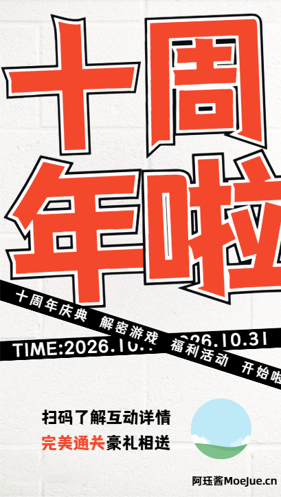

# 阿珏酱Blog十周年庆解密游戏

## 项目介绍
这是一个为阿珏酱Blog十周年庆典特别制作的解密游戏页面。玩家需要发挥巨大的脑洞，一步一步解开谜题，最终获得神秘大奖。
应了小杰的要求,今年**尽可能**在浏览器端完成全部的闯关.

游戏域名: AGX.MoeJue.cn
AGX（A 表示周年 G 表示游戏 X 表示十周年纪念）

解密文章地址:

## 关卡设计笔记

第3关设计成游戏开始界面
~~第4关设计成2233娘对话咨询用户名字 - 有一个复杂高数的选择题,选错电脑直接爆炸卡死~~
用鼠标穿透找到某物
~~后面会通过本地储存提交用户名，判断用户名是否正确提示。你不是我认识的那个李先生~~
~~考虑可以加上闯关进度的存档 - 不考虑了~~
现在我们来玩一个简单的游戏，看左边有一个我妹妹的照片，右边也有一张，你需要找出他们的共同点
~~在场景里面设置一台电脑，可以玩一些小游戏，通关之后会拿到密码 - 不考虑了~~
可以设计一个不让点击的按钮，会到处飘
最终关设计成一个保险柜的样子，密码在过程中，游戏过程中获取
一个全黑的图片，里面包含了某些密码之类的文本，需要通过调节，曝光等参数才能显示出来,灵感是从当我用相机拍了一张全黑的照片开始的.
扫描二维码获取下一关的地址和密码，二维码是左右位置扫描能出两个结果的,或者使用不同的二维码识别平台
假装cf错误页面,错误页面的位置就是下一关的地址
增加一个猜数字的游戏,随机一个数字 出来让用户才,输入数字的方式设计的比较刁钻.最后答对之后就将这个随机的数字设置为密码
增加一个白色加黑色制作成的透明图片,需要在切换暗黑和浅色模式会显示不同的图案,显示不同的信息
增加一个拼图游戏,碎片在游戏的过程中,找其并拼对了才会出现最终的保险箱
增加一个猜猜我是谁的关卡, 黑色人物图片（剪影 / 轮廓图）
可能增加一个拆弹专家
PDF文件藏压缩包 `copy /b demo.pdf + data.zip result.pdf`

## 第0关
- level\bomb\index.html
- 拆弹专家,剪哪一根都会爆炸
- 用于引出主线任务,寻找拼图碎片
- 可能有点唐突,就当作为前传&前戏

## 第一关
- index.html 
- 点击指定的热点区域,手势(较真)位置

## 第1.5关
- level/1.5/black.html
- 刚好第一关结束是黑屏,这里在穿插一个进来
- 一个全黑的图片在页面中，图片里面包含了某些密码之类的文本
- 考验P 图能力,调节曝光度,对比度,饱和度等参数
- 屏蔽了所有按键,也不需要你查看

## 第二关
- /level/googleLogin/login.html captcha.php login.php
- 输入指定用户名(上一关获得)密码
- 输入特殊验证码
- 考验查看源代码能力,破译密码,还是加密的,一上来就是一个小难度(不需要解密,直接复制执行即可)
- 给了前两位数的密码(动态)

## 第2.5关
- cloudflare-error.html
- 虚假的错误页面,实际地址已经显示在界面中了.
- 考验观察能力是否仔细,辨真伪

## PDF压缩包
- pdf藏匿zip压缩包,下一关的地址在压缩包中
- 为了减少难度,会在PDF中给出提示
- 论文参考文献合集

## 第三关
- three/start.html 
- 先弹出一个咨询用户是否满18周岁的界面,类似18+游戏那种
- 然后点击不同的答案显示不同的画面
- 一上来就是2233娘对话咨询用户名字,后续是一些暧昧的对话,最后是关于这个活动的看法
- 第三关很重要会提供很多后续的解密的方向,但是会有一大堆无关紧要的对话掺杂在里面.需要玩家用心对话
- 中间两位密码(动态)

## 第四关
- level/four/QRCode.html
- 一个二维码扫描游戏,左右扫描能出两个结果
- 会在上一关进行提示
- 最后两位密码

## 第五关
- level/5/sister.html
- 一个简单的游戏,看左边有一个我妹妹的照片,右边也有一张,你需要找出他们的共同点
- 也会在第三关进行提示

## 第六关
- level/six/artwork.php
- 一个白色加黑色制作成的透明图片,需要在切换暗黑和浅色模式会显示不同的图案,显示不同的信息
- 句一：「我不住在服务器，也不住在你心里。」
- 句二：「你关掉我之前，我一直陪着你。」
- 在cookies里面返回下一关地址

## 第七关
- level/puzzles/index.php  index.html
- 拼图小游戏,在整个游戏过程中寻找拼图的碎片
- 算是第二个主线任务

## 最后关卡
- last/safe.html last/note.html
- 一个保险柜的场景,需要输入密码,在游戏中获取,一个6位数密码
- 成功后打开进入最好的感谢阶段,显示优惠券,完结撒花

## 技术栈
- HTML5
- php
- CSS3
- 原生 JavaScript

## 宣传图

